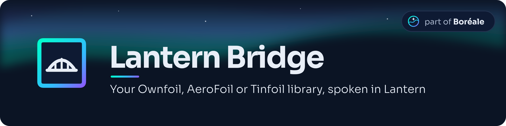

<div align="center">



### Your Ownfoil, AeroFoil or Tinfoil library, spoken in Lantern

**Ownfoil · AeroFoil · Tinfoil shops · Plain folders**

[](https://github.com/JigSawFr/lantern-bridge/actions/workflows/ci.yml)
[](https://lantern.boreale.dev/?utm_source=github&utm_medium=readme)
[](LICENSES/MIT.txt)

[**Specification**](https://lantern.boreale.dev/?utm_source=github&utm_medium=readme) ·
[**SDK**](https://github.com/JigSawFr/lantern-sdk) ·
[**Features**](#-what-it-will-do) ·
[**Quick&nbsp;start**](#-quick-start) ·
[**Releases**](#-releases)

</div>

---

A gateway that presents a library which does not speak [Lantern](https://github.com/JigSawFr/lantern) yet (an [Ownfoil](https://github.com/a1ex4/ownfoil) or [AeroFoil](https://github.com/luketanti/aerofoil) server, any Tinfoil shop, or plain folders of games) as a Lantern server, so that Lantern clients can browse it, download from it and sync with it. It runs next to your library, changes nothing in it, and is built on the [Lantern SDK](https://github.com/JigSawFr/lantern-sdk)'s Python server toolkit.

> [!WARNING]
> **Under construction, nothing released yet.** The repository holds its foundations (packaging, checks, governance) and `lantern-bridge serve`, which runs the SDK's server over an empty library. The sources, the web interface and the image come in the following pull requests, and follow the latest draft of the specification (0.11) until 1.0.

## ✨ What it will do

- 🗂️ **Sources** — plain folders, any Tinfoil shop, Ownfoil (its GraphQL API and live changes) and AeroFoil (saves, cheats, requests, content rating), several at once, merged by SHA-256.
- #️⃣ **Hashes** — Lantern asks for the SHA-256 of every file. The recommended way is to mount the games read-only in the bridge, which hashes them on disk and serves them itself; a remote mode, slower and documented as a fallback, hashes what it downloads once.
- 🔐 **Pairing and tokens** — everything the SDK's toolkit does: pairing with a code or a QR code, device-bound tokens, invitations, a rating cap carried by the token.
- 🖥️ **A small web interface** — status of the sources and of the hashing queue, devices to approve, live logs, configuration.
- 🛡️ **Distrustful of its upstream** — it follows no URL outside the origin it was configured with, and caps what it reads.
- 🧪 **Tested against the specification's conformance suite**, over fake upstreams, in CI.

## 🚀 Quick start

Nothing is released yet, so the bridge runs from a checkout (Python 3.12 or later, [uv](https://docs.astral.sh/uv/)). It serves the Switch packages of the folders you list in `config.toml` (created on the first run, with the server's uid), once they are hashed; any Lantern client, or `curl`, can shake hands with it:

```sh
git clone --recurse-submodules https://github.com/JigSawFr/lantern-bridge
cd lantern-bridge && uv sync
uv run lantern-bridge serve --port 8080
curl http://127.0.0.1:8080/.well-known/lantern
```

A folder is a source in `config.toml`, and its files are named `Name [0100ABCD00010000][v0].nsp`:

```toml
[[sources]]
id = "games"
kind = "folder"
path = "/games"
```

`lantern-bridge status` shows the hashing progress, and `lantern-bridge rehash` computes it again.

A device has to be **paired** before it reads anything (only the handshake is open). `lantern-bridge invite` prints a code for a new device (`--user`, `--devices`, `--hours`, `--admin`), which the device enters in its Lantern client. To let anyone who can reach the server read it instead, set `public = true` in `config.toml`; that is not recommended outside a network you trust.

### 🛒 A Tinfoil shop as a source

```toml
[[sources]]
id = "shop"
kind = "tinfoil"
url = "http://nas.lan:8465/"
user = "me"                 # optional; the password is read from this variable, never from the file
password_env = "SHOP_PASSWORD"
```

The bridge reads the shop's JSON index (and the directories it names), then reads each file **once**, in the background and at `remote_rate` megabytes per second (10 by default, `0` for no limit), to compute its SHA-256, and relays the shop's bytes afterwards, ranges included. The first pass therefore moves the whole library through the bridge: **mounting the games read-only in the bridge and using a `folder` source is faster and recommended**. The shop is treated as untrusted: the bridge follows nothing outside its origin, caps what it reads and ignores names that would leave a folder. A file present in a folder and in a shop is one app, served by the folder.

### 🦊 An Ownfoil as a source

```toml
[[sources]]
id = "ownfoil"
kind = "ownfoil"
url = "http://nas.lan:8465/"
user = "me"                 # optional; the password is read from this variable, never from the file
password_env = "OWNFOIL_PASSWORD"
```

The bridge asks Ownfoil's GraphQL API (`/api/graphql`) for what it holds: each file (identified by Ownfoil, not guessed from a name), then the **sheets** (name, summary, description, developer, publisher, release date, genres, languages) and the **images** (icon, banner and screenshots Ownfoil stores itself), which the bridge serves on its own address. An image Ownfoil only points to elsewhere is not fetched, and a file is taken for an image only if its first bytes say so. The files themselves are read once to be hashed and relayed afterwards, like a Tinfoil shop's: **mounting the games read-only and adding a `folder` source is faster**, and the folder then serves the files while Ownfoil keeps giving the sheets.

If the account may read Ownfoil's live feed (`/api/ws`, administrators only), the bridge reads the shop again as soon as a task of Ownfoil ends, instead of waiting for the next regular read (every five minutes). Without it, nothing is lost.

### 🪂 An AeroFoil as a source

```toml
[[sources]]
id = "aero"
kind = "aerofoil"
url = "http://aerofoil:8465/"
user = "bridge"            # the service account
password_env = "AEROFOIL_PASSWORD"

[[sources.logins]]         # optional: Lantern account "alice" acts as this AeroFoil user
account = "alice"
user = "alice"
password_env = "AEROFOIL_ALICE"
```

The shop is read like any Tinfoil shop. On top of it, the first `aerofoil` source of the file also gives:

- **Saves.** The bridge keeps its own copy of each account's backups and mirrors it both ways: a backup made
  through Lantern is uploaded (`account` and `device` kinds, as AeroFoil's save types), and one that only
  AeroFoil has (from CyberFoil, say) is brought over, zip archives only. A backup deleted on one side is
  deleted on the other. The bridge turns encrypted backups off, since AeroFoil keeps plain archives.
- **Cheats.** The cheat sets of AeroFoil appear as Lantern cheat sets. A client with the `cheats.write` scope
  writes through to AeroFoil, whose login must then be an administrator's, or the write is refused.
- **Requests.** A request is also made on AeroFoil, and when AeroFoil closes it (`done`) or denies it
  (`declined`), the account is told.

A Lantern account with no `logins` entry acts as the service account; with neither, nothing is mirrored for it.
The age-rating ceiling is not read from AeroFoil: set it on the Lantern token.

### 🖥️ Administration pages

Open `http://<host>:8080/admin/`. The first time, the server writes a one-time **setup code** in its log (look for `setup code`); enter it with the name and password you want for the administrator. Then sign in to see the hashing progress and the sources, approve or refuse the devices that ask to pair, revoke a device, follow the logs live, and:

- **Library**: every title the bridge knows, as a shelf or a dense list (search, kind, source, hashing state, sort) and a page per title: its games, updates and DLC, its files by source with their SHA-256, its cheats, what Atlas says of it, and a button to hash one file or the whole title again (`lantern-bridge rehash --title <id>` does the same).
- **Activity**: the transfers in progress, the machines that called the library, the rates and the hashing, live. Simple requests (the container's health check on `/.well-known/lantern`, a browser on `/` or `/favicon.ico`, a scanner's guesses) are counted apart and never make a machine or a rate; a request with a token is always the library's. (The live blocks arrive over one server-sent stream each, `/admin/live`, sent when the content changes; a browser without `EventSource` asks again every two seconds.)
- **Developer** (off unless `developer = true`): the last requests, the slowest hashing, a title as raw JSON, a few actions.
- **Sources**: add, remove, reorder and test a folder or a shop.
- **Settings**: the name, the hashing rate and the access mode, the notifications, the integrations, a read-only account, MQTT and a backup, with a contents bar, a search box, and one Save all bar that appears when cards were edited (the read-only account keeps its own button). The page writes `config.toml` (keeping the keys it does not know); the bridge reads it at startup, and the pages say when a restart is due.
- **Accounts**: each account's scopes and devices, and, with an `aerofoil` source, the AeroFoil user it acts as (only the name of the variable holding the password is kept).
- **Invitations**: a code that pairs a device without approval, for 1, 7 or 30 days and a number of devices.
- **Diagnostic**: a JSON file with versions, sources, counts and recent warnings, and no secret.

The pages wear Boréale's night, in English and French (the browser's language, or the switch in the header), with the fonts served from the bridge. Dark is the look; a light theme is one click away in the header (a choice of that browser, kept in a cookie). The header keeps the everyday pages in view and puts the settings ones under "Manage", and both keep to WCAG AA contrast.

The pages answer the local network only (private and loopback addresses). Three settings in `config.toml` fit them to a proxy or a stricter network:

- `admin_allow = ["192.168.1.0/24"]` narrows the allowed addresses to those networks (the machine itself always may).
- `trusted_proxies = ["172.18.0.0/16"]` names the reverse proxies whose `X-Forwarded-For` and `X-Forwarded-Proto` are believed (read from the right, so a client cannot write its own address); the checks above, the sign-in limits and the cookie's `Secure` flag then follow the real client and HTTPS. Without it those headers are ignored.
- `admin_hosts = ["bridge.example.org"]` lists the names the pages answer to (the `Host` header); without it they answer to addresses, one-word names and local ones (`bridge.lan`), which a DNS rebinding page cannot be called. Behind a proxy with a real domain, list it.

Mind that Docker's userland proxy (and Docker Desktop) can show every request as coming from the gateway, a private address: `admin_allow` then protects nothing, and the password is the defence. Publish the port with the default bridge network on Linux, or put a proxy in front and name it in `trusted_proxies`. Wrong passwords are counted per address (5 in 5 minutes) and per name (30 in 15 minutes); a session ends after 30 idle minutes (8 hours at most) and keeps at most 8 live streams. The session cookie is `HttpOnly` and `SameSite=Strict`, and `Secure` over HTTPS. `/metrics`, when the settings turn it on, follows the same rule (the local network only, whatever `admin_lan_only` says). The browser loads nothing from elsewhere.

What an administrator types is trusted: a source's address, the webhook and the notification address are called from the bridge, `localhost` and a cloud's metadata address included (redirects are not followed). Keep the pages on a network you trust. The backup holds the settings (names of environment variables, never their values), the index and the journal, nothing secret.

**Atlas.** By default (`atlas = true`) the bridge fetches one public file once a day, [Atlas](https://atlas.boreale.dev)'s `platforms/switch/games.json` (CC0: names, developers, publishers, genres, series and modes from Wikidata, Steam's rating), from `raw.githubusercontent.com`, keeps it in its state directory (`atlas.json`) and uses it to fill in the genres, developer and publisher a source leaves empty. Nothing about your library is sent: it is a plain `GET`. Set `atlas = false` (or untick it in the settings) and the bridge contacts nothing outside your sources.

**MQTT.** Give the bridge a broker (*Settings › MQTT broker*, or a `[mqtt]` table: `host`, `port`, `user`, `password_env`, `prefix`, `tls`) and it publishes under `<prefix>/<uid>` (`lantern-bridge` unless you change it): `state`, a retained JSON document of `schema` 1 every 30 seconds (status and checks, titles, files hashed and waiting, traffic, each source up or not; no path and no name of a device), `problems` (how many checks are not good), `event` (one JSON line per journal entry as it happens, not retained: no path, no title), and `availability` (`online`, and `offline` as its last will). An order on `order/rescan` reads every source again now. Home Assistant's [Boréale integration](https://github.com/JigSawFr/boreale-ha) reads these topics.

**Webhook.** Set an address in *Settings* (or `webhook` in `config.toml`) and the bridge sends it one POST of JSON when scans found changes, at most every ten seconds: `schema` 1, `event` `scan`, the bridge (id, name, version) and, per source, how many files were `added`, `changed` or `removed`. No path and no title. A call that fails is logged and not repeated. A secret the receiver wants goes in the address's path (no credentials in the address).

**Notifications.** Set an address in *Settings* (or `notify` in `config.toml`) and the bridge sends it a short text when a source stops answering (priority high), when it is back, and when a newer release is out: a POST of plain text with ntfy-style `Title`, `Priority` and `Tags` headers, which ntfy reads as is (`https://ntfy.sh/your-topic`). No path and no title of your library is in it; a call that fails is logged and not repeated.

**Backup.** *Settings › Backup* downloads a zip, and `lantern-bridge backup -o file.zip` writes one (the bridge may run): the settings (`config.toml`, no secret in it: passwords are read from the environment), the index with the hashes already computed and the activity history. Pairings are not in it, so a device pairs again. To restore, stop the bridge and run `lantern-bridge restore file.zip` (in a container, with the file in the `./config` volume: `docker run --rm -v ./config:/config lantern-bridge restore file.zip`); it refuses an archive of a newer schema, and keeps what it replaces beside it as `.before-restore`.

**Updates.** On by default; *Settings › Updates* (`update_check = false`) turns it off. The bridge reads GitHub's latest release once a day and says on the overview when it is newer (and `update` in the MQTT state). It sends only the request, so GitHub sees the machine's address as for any download, and it downloads and installs nothing.

**Disk space.** The overview shows the room left on the volume of each folder, and the health warns when the volume of the state (the index) has less than `low_disk_mb` free (500 MiB by default, *Settings*; it fails below 20 MiB). A folder full of games is not a fault, so a folder's room is shown and not judged.

**Changing the settings safely.** Each save keeps the file it replaces beside it (`config.toml.previous`, one level, same permissions); *Settings › Undo the last change* brings it back, and pressing it again brings the change back. *Try it first*, under *Add a source*, reads a folder or asks a shop for its listing without saving anything, and a refused form keeps what was typed. *Setup guide* (`/admin/start`) walks an empty bridge through its first source, its first read and its first pairing.

**Journal.** *Journal* lists what happened to the bridge, newest first: it started, a scan found changes (`+added ~changed -removed` for a source), a source stopped answering and came back (the turn, not every pass), a newer release came out, settings were saved or taken back, a device was paired, refused or revoked, a backup was restored (`lantern-bridge restore` writes that line itself). It can be downloaded as CSV or JSON (cells that a spreadsheet would run as a formula are quoted). It is kept in `activity.sqlite3` for 90 days (1000 lines at most), holds no path and no title, and is for the administrator only. It is in the backup with the rest of that file.

**Read-only account.** *Settings › Read-only account* makes a second sign-in for someone who only looks: it opens the overview, the library (with its checks and exports) and the activity, and nothing else. It cannot change a setting, a pairing or a source, take a backup, or read the settings, the logs or the developer page, and every request that is not a page it may read is refused on the server, not only hidden. Removing it closes its sessions at once. The administrator's name and the observer's must differ.

### 🐳 In a container

Build the image from a checkout (it needs the `sdk/` submodule) and mount the folders read-only: the hashes are then computed in place, which is the recommended way. The configuration and the state (index, pairings) live in `/config`.

```sh
docker build -t lantern-bridge .
docker run -p 8080:8080 -v ./config:/config -v /srv/games:/games:ro lantern-bridge
```

To pair a device: `docker exec <container> lantern-bridge invite`. The image runs as an unprivileged user (uid 10001), so `./config` must be writable by it. For now it is built by the CI, not published.

## 📦 Releases

Nothing is released yet. A release will be made by this repository's CI from a tag, with release-please, and published on [the releases page](https://github.com/JigSawFr/lantern-bridge/releases).

## 🤝 Contributing

[CONTRIBUTING.md](CONTRIBUTING.md) · [Code of conduct](CODE_OF_CONDUCT.md) · [Security](SECURITY.md)

Issues and pull requests go on this repository. A change to the protocol itself is proposed in [the specification's repository](https://github.com/JigSawFr/lantern). A security flaw is reported privately, as [SECURITY.md](SECURITY.md) says.

## 🧑‍💻 Development

```sh
git clone --recurse-submodules https://github.com/JigSawFr/lantern-bridge   # sdk/ is the Lantern SDK
uv sync
uv run pytest
uv run ruff check . && uv run ruff format --check .
uv run mypy
uv run lantern-bridge --version
uv run lantern-bridge serve --port 8080   # then: curl http://127.0.0.1:8080/.well-known/lantern
```

Python 3.12 or later. The Lantern SDK is the `sdk/` submodule, fixed on a commit until it has a release (`git submodule update --init` after a pull). [CONTRIBUTING.md](CONTRIBUTING.md) says how to propose a change; a security flaw is reported privately, as [SECURITY.md](SECURITY.md) says.

## 🧭 How it's made

[](https://boreale.dev/how/?utm_source=github&utm_medium=readme)

Lantern Bridge is built by [JigSawFr](https://github.com/JigSawFr), a full-stack
engineer who has shipped production software for years, with AI coding
assistants as part of the toolbox.

- **I decide**: architecture, scope, what ships and what doesn't.
- **AI helps write**: first drafts of code and tests, docs, and the translations.
- **I review everything**: every change is read, tested and signed before it
  reaches `main`.

Nothing in the bridge calls an AI service. More on [boreale.dev](https://boreale.dev/how/?utm_source=github&utm_medium=readme).

## 📜 License and credits

**MIT**, see [`LICENSES/MIT.txt`](LICENSES/MIT.txt); every file says its licence ([REUSE](https://reuse.software/)). Maintained by [JigSawFr](https://github.com/JigSawFr), part of [Boréale](https://boreale.dev/?utm_source=github&utm_medium=readme).
